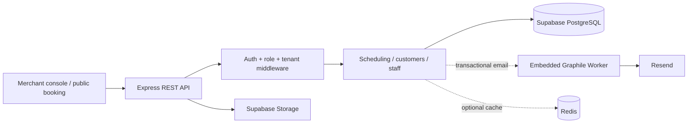

# Systemly — Multi-Tenant Booking SaaS Backend

**Production-oriented appointment, staff and business-operations API built with Node.js, TypeScript and PostgreSQL.**

[Merchant & booking frontend](https://github.com/Ahmed2902/Systemly-frontend) · [Website](https://systemly.me) · [Detailed architecture](./architecture.md) · [OpenAPI contract](./openApi.json)

## Project snapshot

Systemly models independently administered appointment businesses and their customer-booking flows. The API prioritizes tenant isolation, secure sessions, race-safe scheduling, and reliable transactional email delivery.



**Engineering highlights:** business-timezone scheduling with UTC persistence; PostgreSQL advisory locks for appointment conflict prevention; opaque HttpOnly refresh sessions with CSRF/Origin defenses; tenant-level RBAC; embedded durable email jobs; Docker and Azure Container Apps.

**Stack:** Node.js 22, Express, TypeScript, PostgreSQL, Prisma, Graphile Worker, Redis (optional), Jest, OpenAPI, Docker, GitHub Actions.

The architecture diagram shows responsibility boundaries; full runbooks and environment requirements remain below.

---


Systemly is a multi-tenant appointment-business API for salons, clinics, spas, and related service businesses.

## Runtime architecture

One Node.js process runs:

- Express REST API
- embedded Graphile Worker for durable email jobs

Supporting services:

- PostgreSQL / Supabase — source of truth, scheduling locks, Graphile jobs
- Redis — optional fail-open analytics cache
- Supabase Storage — public website media and private appointment media
- Resend — transactional email provider
- Sentry — error monitoring
- GitHub Container Registry (GHCR) — production Docker image storage
- Azure Container Apps — production API container

There is no separate worker service and no BullMQ/reminder runtime in V1.

## Local development

```bash
npm ci
npm run prisma:generate
npm run prisma:migrate:deploy
npm run build
npm test
npm start
```

For schema development, create normal forward Prisma migrations; production uses `prisma migrate deploy` only.

## Production container

The Docker image:

- uses Node 22
- generates Prisma for the runtime OpenSSL environment
- prunes development dependencies
- runs as the non-root `node` user
- exposes port 3000
- has `/health/live` and `/health/ready` probes

`/health/live` means the HTTP process is alive. `/health/ready` also requires PostgreSQL and the embedded Graphile email worker to be ready.

## Database connections

Use two credentials deliberately:

- `DATABASE_URL` — runtime Supabase Session Pooler connection used by Express + Graphile Worker
- `DATABASE_MIGRATION_URL` — GitHub Production secret used only by the deployment workflow for Prisma and Graphile schema migrations

Never put `DATABASE_MIGRATION_URL` in the running Container App.

## Required production configuration

The application fails fast in `NODE_ENV=production` when required core configuration is missing.

Core:

- `DATABASE_URL`
- `JWT_SECRET`
- `JWT_REFRESH_SECRET`
- `CSRF_SECRET`
- `FRONTEND_URL`
- `APP_URL`

Google OAuth:

- `GOOGLE_CLIENT_ID`
- `GOOGLE_CLIENT_SECRET`

`GOOGLE_REDIRECT_URI` is optional compatibility configuration. Production derives the callback from `APP_URL` so a stale override cannot redirect production OAuth to another host.

Email:

- `RESEND_API_KEY`
- `EMAIL_FROM`
- `EMAIL_DELIVERY_MODE=worker` on the Azure runtime

Observability:

- `SENTRY_DSN`

Storage:

- `SUPABASE_URL`
- `SUPABASE_SERVICE_ROLE_KEY`
- `SUPABASE_PUBLIC_MEDIA_BUCKET`
- `SUPABASE_PRIVATE_MEDIA_BUCKET`

Optional:

- `REDIS_URL` — analytics cache only; Redis failure must not break core auth/booking flows
- `PORT` — defaults to 3000

JWT and CSRF secrets must contain at least 32 characters in production.

## Authentication

- Access token: short-lived JWT returned in response bodies and sent as `Authorization: Bearer ...`
- Refresh token: opaque HttpOnly cookie
- Refresh/logout cookie flows: signed CSRF token + Origin validation
- Google OAuth: Authorization Code + browser-bound state + PKCE; callback establishes the normal refresh-cookie session and never puts Systemly tokens in the redirect URL
- Email verification/password reset: hashed one-time tokens stored durably in PostgreSQL; Redis may cache but is never authoritative

## Scheduling/timezones

- recurring availability is stored/interpreted as business-local wall-clock rules
- business timezone is authoritative for availability and local booking input
- appointment and segment instants are stored as UTC timestamps
- booking writes use PostgreSQL advisory locks to prevent simultaneous double booking

## Media

- website branding/gallery media is public
- appointment/clinical media is private
- private uploads use signed upload tickets, ownership/path validation, metadata checks, and short-lived signed reads

## Background email

The only V1 Graphile task is `send_email`, used for authentication and staff-invitation mail.

The worker runs inside the same Node.js process as the HTTP API. The pilot Azure deployment uses `minReplicas=0` and `maxReplicas=1`, so the worker only runs while the Container App has an active replica. Queued jobs remain durable in PostgreSQL and are consumed after the app wakes again. Do not rely on this topology for strict wall-clock scheduled jobs that must execute while the service is idle.

After production deployment, verify the complete queue/provider path with:

```bash
node dist/src/scripts/verifyEmailWorker.js you@example.com
```

Run it with the production environment loaded while the API revision is active. Confirm both the received email and an `email_sent` log event.

## CI/CD

Backend CI on every PR/main push verifies:

- dependency install
- Prisma generation
- TypeScript
- OpenAPI
- PostgreSQL test suite
- production Docker build
- image-based Prisma + Graphile migrations
- non-root runtime
- liveness/readiness

Production deployment runs only after successful Backend CI on `main` and when repository variable `AZURE_DEPLOY_ENABLED=true`.

The production Docker image is stored in GitHub Container Registry rather than Azure Container Registry. GitHub Actions publishes the tested SHA using the repository `GITHUB_TOKEN`. The Azure Container App pulls the private GHCR image using a separate read-only `GHCR_PULL_TOKEN` stored as a GitHub Production secret and then saved as a Container App registry credential.

Deployment order:

1. build/push the tested SHA to `ghcr.io/ahmed2902/systemly-backend`
2. apply Prisma migration
3. apply Graphile Worker schema migration
4. configure the Container App to authenticate to private GHCR
5. update the Azure Container App to that exact image
6. enforce external HTTPS ingress on port 3000
7. set pilot scaling to min 0 / max 1
8. wait for `/health/ready`

For the zero-fixed-cost pilot, configure the Container Apps environment logging destination as `Don't save logs`. Live log streaming remains available and Sentry provides persistent application error monitoring.

## Operational docs

Before accepting clients, complete `docs/GO_LIVE_CHECKLIST.md`.
